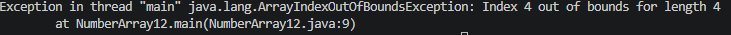

# JOBSHEET 9 - One-Dimensional Arrays

**Student Identity:**
* **Name:** Fathan Nur Hidayat
* **NIM:** 26410702084
* **Class / Student Attendance:** 1I / 12

---

## 1: OBJECTIVE

The following are the objectives of the practical work in this chapter:

1. Students are able to understand the concept of one-dimensional arrays and how to declare, initialize and access their elements in the Java programming language.
2. Students are able to write programs that use one-dimensional arrays to store and process data including the use of for and foreach loops.
3. Students are able to apply arithmetic operations to array elements, such as calculating the total average, highest value, and lowest value.
4. Students are able to apply simple searching and sorting algorithms to one-dimensional arrays.
5. Students are able to apply one-dimensional arrays to solve case studies that are relevant to campus life and everyday situations.


---

## 2: THEORETICAL BACKGROUND

### 2.1 What Is An Array? 

An array is a data structure that stores a collection of data of the same type, in sequence, within a single variable. Instead of creating a separate variable for each piece of data (for example, score1, score2, score3, ... score10), an array allows all of the data to be stored in one variable and accessed by index. In Java, arrays are homogeneous (all elements must be of the same type) and fixed in size — the size cannot be increased or decreased once the array has been instantiated.

Internally, array elements are stored contiguously in memory, so the computer can access any element directly by its index without having to traverse the preceding elements one by one. This is one reason why accessing an array element (for example, scores[5]) is very fast compared with other data structures that are not stored contiguously.

#### 2.2 Declaring and Initializing Arrays

There are several ways to declare and initialize a one-dimensional array in Java, depending on whether
the element values are known from the start or will be filled in later.

| Syntax | Explanation |
|--------|-------------|
| `int[] numbers = new int[4];` | Declares an empty array with a capacity of 4 elements. All elements are automatically filled with the default value (0 for the int type) until they are explicitly assigned. |
| `int[] numbers = {5, 13, -7, 17};` | Declares an array and initializes its element values directly. The array size automatically matches the number of values written. |
| `int[] numbers = new int[]{5, 13, -7, 17};` | Another form of direct initialization, commonly used when an array is declared as a method argument or a return value. |
| `String[] menu = {"Fried Rice", "Pulled Tea"};` | Arrays can also store non-primitive types such as String, as long as all of the elements are of the same type. |

### 2.3 Indexes, Array Length, and Common Errors

Array indexes in Java always start at 0, so the first element has index 0 and the last element has index (array length − 1). The length or capacity of an array can be obtained through the .length attribute, for example numbers.length. Note that .length is an attribute (not a method), so it is written without parentheses — unlike String, which uses the .length() method.

The most common mistake among beginners is trying to access an index outside the range of the array, for example accessing numbers[4] in an array with a capacity of 4 elements (the valid indexes are only 0 to 3). This mistake causes the program to terminate with an ArrayIndexOutOfBoundsException while it is running (a runtime error), rather than when the program is compiled.

| Default Value | Applies to Type |
| ------------- | --------------- |
| `0 (zero)` | The default value of array elements of type int or double before they are explicitly assigned|
| `false` | The default value of array elements of type boolean. |
| `null` | The default value of array elements of object/reference types, for example String. |

### 2.4 Processing Array with Loops

There are several ways to iterate over all of the elements of an array in Java, each with its own use.

| Technique | Use |
| --------- | --- |
| `for (int = 0; i < arr.length; i++)`| The most flexible approach — the index i can be used to access or modify element values, or to compare an element with another element (for example, arr[i] and arr[i+1]) |
| `for (int value : arr)` | Foreach loop (enhanced for loop) — more concise for simply reading or displaying each element, but it cannot provide the index of an element directly and cannot be used to modify the contents of the array. |
| `Arrays.toString(arr)`| A helper method from the java.util.Arrays class that displays the entire contents of an array on a single line in the format [element1, element2, ...], without the need to write a manual loop. |
|  `Arrays.sort(arr)` | A helper method for sorting an array in ascending order using an internally optimized sorting algorithm. |

### 2.5 Common Array Operations: Aggregation, Searching, and Sorting

The three most common operations applied to arrays are:
• Aggregation (total, average, maximum/minimum value) — performed by traversing all of the elements while accumulating the result in a single variable (for example, total) or comparing each element with a temporary holder variable (for example, highest).

• Searching — finding out whether a value exists in an array and, if so, at which index it is located. The simplest technique is linear search, which examines the elements one by one from the beginning until the value is found or all of the elements have been checked.

• Sorting — rearranging the elements of an array in a particular order (ascending or descending). One of the simplest sorting algorithms to learn is bubble sort, which works by repeatedly comparing two adjacent elements and swapping their positions.

To give an idea of efficiency (not to be memorized, only to build intuition), the following are the worstcase time complexities of each technique, expressed in Big-O notation — the larger n (the number of array elements) becomes, the more noticeable the difference in efficiency is:

| Operation | Time Complexity (Big-O) |
| --------- | ----------------------- |
| `Accessing an element by index (arr[i])` | O(1) — constant time, regardless of the size of the array |
| `Linear Search` | O(n) — time grows in direct proportion to the number of elements, because the elements are checked one by one. |
| `Bubble Short` | O(n²) — time grows quadratically with the number of elements, because there are two nested loops. |

### 2.6 Array vs ArrayList: When to use Which?

Java also provides the ArrayList data structure (part of the Java Collections Framework), which is similar to an array but can grow or shrink dynamically according to the needs of the program while it is running.

| Aspect | Comparison |
| ------ | ---------- |
| `Size` | An array is fixed in size from the moment it is instantiated. An ArrayList can grow or shrink dynamically. |
| `Element Type` | An array can hold primitive types (int, double, etc.) directly. An ArrayList can only hold object types (Integer, Double, etc. must be used). |
| `Performance` | Arrays are generally slightly faster and more memory-efficient because their structure is simpler. |
| `Ease of use` | ArrayList provides many ready-to-use methods (add, remove,contains, etc.) that make data processing easier than with arrays. |

As a general rule, use an array when the amount of data is known and will not change while the program is running (for example, the number of days in a week, or a fixed number of menu items). Use an ArrayList when the amount of data may grow or shrink dynamically (for example, a list of orders that keeps growing). ArrayList will be discussed in more detail in the next lab sheet.

### 2.7 Relevance of One-Dimensional Array to the Lab Case Studies

In this lab, one-dimensional arrays are applied to a case study relevant to the campus environment, namely the management of student scores in the Academic Information System (SIAKAD) — including score entry, determination of pass/fail status, and the calculation of statistics such as the average and the class grade category. One-dimensional arrays are also applied to a case study on order management at a campus café, covering the recording of the menu list, menu searching, order recording, and total cost calculation.
Both case studies represent usage patterns of arrays that are very common in real-world applications: storing a collection of similar data (student scores, a menu list, a price list), and then processing it using a combination of loops, aggregation, searching, and sorting, as explained in the previous sections.

> **Running the Program in VS Code:** All program code in this lab sheet is written and run using Visual Studio Code. Create a new file with the name requested in each step (File > New File, then save it using Save As with the appropriate name and the .java extension). To compile and run the program, open the integrated VS Code terminal via the Terminal > New Terminal menu or the shortcut Ctrl + \` (backtick), then run the command `javac FileName.java` to compile, followed by `java FileName` (without .java) to run the program.    

## 3. Lab Exercises

### 3.1 Experiment 1: Declaring, Initializing, Filling, and Displaying Array Elements

### 3.1.1 Program Code Java
```java
import java.util.Arrays;

public class NumberArray12{
    public static void main(String[] args) {
        
        int[] numbers = new int[4];
        numbers[0] = 5;
        numbers[1] = 13;
        numbers[2] = -7;
        numbers[3] = 17;

        for(int i = 0; i < numbers.length; i++){
            System.out.println("numbers[" + i + "] = " + numbers[i]);

        }
        for(int number : numbers){
            System.out.println(number);
        }
        System.out.println(Arrays.toString(numbers));
    }
}
```

#### 3.1.2 Execution Result / Screenshot Output
The following is an example of the *output* display after the program is run.:

.png)

#### 3.1.3 Answers to Questions / Reflection Questions
* **Question 1:** If the elements of the numbers array are changed to 5.0, 12867, 7.5, 2000000, what happens? Why does this happen?
  * **Answer:** Error, because the data type is integers, so we cannot input the double data type.
* **Question 2:** Modify the program above by initializing the array elements at the same time the array is declared (without new int[4] and without filling the elements one by one).
  * **Answer:** 
```java
import java.util.Arrays;

public class NumberArray12{
    public static void main(String[] args) {
        
        int[] numbers = {5, 13, -7, 17};

        for(int i = 0; i < numbers.length; i++){
            System.out.println("numbers[" + i + "] = " + numbers[i]);

        }
        for(int number : numbers){
            System.out.println(number);
        }
        System.out.println(Arrays.toString(numbers));
    }
}
```
* **Question 3:** Change the display statement in step 4 to the following: System.out.println("numbers[" + i + "] = " + numbers[i] + ", doubled = " + (numbers[i] * 2)); What is the output of the program? Explain the meaning of the statement.
  * **Answer:** The output of the program is: .png)
  The meaning of the statement is to doubled the i (multiplied by 2) and show the result of it.
* **Question 4:** If the condition in the for loop above is changed to i <= 4, what is the output of the program? Why?
  * **Answer:** It will show `Exception in thread "main" java.lang.ArrayIndexOutOfBoundsException: Index 4 out of bounds for length 4 at NumberArray12.main(NumberArray12.java:9)`. It's because the array is only have 4 elements, and index 4 would be the fifth element, which isn't there.

Result

* **Question 5:** What is the difference between displaying an array using a for loop, a foreach loop, and Arrays.toString() in step 5? When should each one be used?
  * **Answer:** The classic for loop gives full control through an index, so it suits cases where the index is needed, elements must be modified, or traversal is unusual, though it is more prone to off-by-one errors. The for-each loop (for (int number : numbers)) is shorter and safer, making it ideal for simply reading each element, but it has no index and cannot modify primitive elements. Arrays.toString(nums) prints the whole array in one line, such as [5, 13, -7, 17], which is best for quick output and debugging, though its format is fixed and multidimensional arrays need Arrays.deepToString().
---

### 3.2 Experiment 2: SIAKAD Case Study — Entering Student Scores and Pass/Fail Status

In the Academic Information System (SIAKAD), lecturers need to enter students' final scores and quickly determine the pass/fail status of each student.

#### 3.2.1 Program Code Java
```java
import java.util.Scanner;

public class ScoreArray12{
    public static void main(String[] args) {
        Scanner input = new Scanner(System.in);

        int[] finalScores = new int[10];

        for (int i = 0; i < finalScores.length; i++) {
            System.out.print("Enter the score for student #" + (i + 1) + ": ");
            finalScores[i] = input.nextInt();
        }
        for (int i = 0; i < finalScores.length; i++) {
            String status = (finalScores[i] > 70) ? "PASS" : "FAIL";
            System.out.println("Student #" + (i + 1) + ": " + finalScores[i] + " (" + status + ")");
        }
        input.close();
    }
}

```
#### 3.2.2 Execution Result / Screenshot Output
The following is an example of the *output* display after the program is run.:


#### 3.2.3 Answers to Questions / Reflection Questions
* **Question 1:** What does the condition i < finalScores.length in the loop above mean?
  * **Answer:** finalScores.length is the number of elements in the array, which is 10 here. The loop runs while i is less than 10, so i takes the values 0 through 9. These are exactly the valid indexes of the array, because Java arrays start at index 0 and the last index is length - 1.
* **Question 2:** Modify the program so that it displays only the scores of students who passed (score > 70), without displaying those who failed. Explain the flow of the program!
  * **Answer:** Output program: 
```java
for (int i = 0; i < finalScores.length; i++) {
            if (finalScores[i] > 70) {
                String status = "PASS";
                System.out.println("Student #" + (i + 1) + ": " + finalScores[i] + " (" + status + ")");
            }
        }
```
* **Question 3:** Change the loops in steps 4 and 5 from for loops to foreach loops. Can all parts of the program be converted to foreach? Explain which parts can and cannot be converted, along with the reasons.
  * **Answer:** Yes, it can be inverted to foreach, but it only reads values, so for-each works. However, for-each gives no index, so the student number (i + 1) must be tracked with a separate counter variable like number, as shown below.
```java
int number = 1;
for (int score : finalScores) {
    String status = (score > 70) ? "PASS" : "FAIL";
    System.out.println("Student #" + number + ": " + score + " (" + status + ")");
    number++;
}
```
    A for-each loop can be used when a loop only reads the elements of an array, but a classic for loop must be kept when the loop writes values into the array or needs the index.
* **Question 4:** Modify the program so that it also calculates and displays the number of students who passed and the number of students who failed at the end of the program.
  * **Answer:** Output modified program code: 
```java
import java.util.Scanner;

public class ScoreArray12{
    public static void main(String[] args) {
        Scanner input = new Scanner(System.in);

        int[] finalScores = new int[10];
        int passCount = 0, failCount = 0;
        for (int i = 0; i < finalScores.length; i++) {
            System.out.print("Enter the score for student #" + (i + 1) + ": ");
            finalScores[i] = input.nextInt();
        }
        for (int i = 0; i < finalScores.length; i++) {
            String status;
            if (finalScores[i] > 70) {
                status = "PASS";
                passCount++;
            } else {
                status = "FAIL";
                failCount++;
            }
            System.out.println("Student #" + (i + 1) + ": " + finalScores[i] + " (" + status + ")");
        }

        System.out.println();
        System.out.println("Number of students who passed: " + passCount);
        System.out.println("Number of students who failed: " + failCount);
        input.close();
    }
}
```

---

### 3.3 Experiment 3:  Arithmetic Operations on Arrays — Total, Average, Highest and Lowest Scores

This experiment continues the SIAKAD case study to produce a summary of student scores, as commonly shown in an end-of-semester score recap.

#### 3.2.1 Program Code Java
```java
import java.util.Scanner;

public class CafeDoWHile12 {
    public static void main(String[] args) {
        Scanner sc = new Scanner(System.in);

        int coffee, tea, bread, totalPrice, coffePrice = 12000, teaPrice = 7000, breadPrice = 20000;
        String customerName;

        do{
            System.out.print("Enter customer name(type 'cancel' to exit): ");
            customerName = sc.nextLine();
            if(customerName.equalsIgnoreCase("cancel")){
                System.out.println("Transaction canceled.");
                break;
            }
        
            System.out.print("Coffe Quantity: ");
            coffee = sc.nextInt();
            System.out.print("Tea Quantity: ");
            tea = sc.nextInt();
            System.out.print("Bread Quantity: ");
            bread = sc.nextInt();
            totalPrice = (coffee * coffePrice) + (tea * teaPrice) + (bread * breadPrice);
            System.out.println("Total Amount: Rp. " + totalPrice);
            sc.nextLine();
        }while(true);
        System.out.println("All transactions completed.");
        
        sc.close();
    }    
}

```

#### 2.3.2 Execution Result / Screenshot Output
The following is an example of the *output* display after the program is run.:


#### 2.2.3 Answers to Questions / Reflection Questions
* **Question 1:** In this DO-WHILE loop, if the first customer name entered is “cancel”, how many times is the loop executed?
  * **Answer:** 1 time. The body runs first, and the condition is checked afterward. So even if the very first input is “cancel”, the loop body still starts once.
* **Question 2:** State the stopping condition used in this DO-WHILE loop!
  * **Answer:**
  ```java
  customerName.equalsIgnoreCase("cancel")
  ``` 
  The loop stops when the cashier types cancel as the customer name. equalsIgnoreCase ignores letter case, so cancel, CANCEL, and Cancel all work. The loop runs repeatedly for each customer and terminates when the input customerName equals “cancel” (case-insensitive), which triggers break.
* **Question 3:** What is the function of using the value true in the DO-WHILE condition?
  * **Answer:** Using true as the condition creates an infinite loop. Since true is always true, the condition never becomes false, so the loop never ends by itself and always repeats for the next customer. The loop is terminated manually through break when the sentinel value “cancel” is entered.
* **Question 4:** Why does this DO-WHILE loop still run even though it has no initialization and update
components?
  * **Answer:** A DO-WHILE loop does not need initialization and update components because it is controlled by a condition rather than a counter. In this program, the loop repeats through while(true) and ends through break when the sentinel value “cancel” is entered.
---

## 3: ASSIGNMENT

The following is a list of tasks to be performed in this Jobsheet:

- [x] **Task 1:** In this section, students are required to apply a *WHILE loop* with *Multiple IF-ELSE (IF-ELSE IF)* conditions to process the ticket sales of several customers at a cinema. For each customer, the program reads the ticket quantity, rejects negative values and asks for re-entry, then applies the discount rules (10% for more than 4 tickets, 15% for more than 10 tickets) to the ticket price of Rp 50,000. The program accumulates the total number of tickets sold and the total revenue for the day.
- [x] **Task 2:** In this section, students are required to apply a *WHILE loop* and *IF-ELSE* conditions to process the parking fees of several vehicles. For each vehicle, the program reads the parking duration and the vehicle type, then calculates the fee using the rate of Rp 3,000 per hour for cars or Rp 2,000 per hour for motorcycles. The loop continues as long as the input is not 0, and the program then displays the total parking fees collected, following the flowchart provided.

### 3.1 Implementation Task Code

#### Task 1:  Total Daily Cinema Ticket Sales
#### 3.1.1 Program Code Java
```java
import java.util.Scanner;

public class Assignment112 {
    public static void main(String[] args) {
        Scanner sc = new Scanner(System.in);

        int ticketQuantity, ticketPrice = 50000, totalTickets = 0;
        
        while(true) {
            System.out.print("Enter ticket quantity: ");
            ticketQuantity = sc.nextInt();
            if(ticketQuantity == 0){
                break;
            }
            if(ticketQuantity < 0 ){
                System.out.println("Invalid ticket quantity! Please enter the quantity again.");
                continue;
            }
        totalTickets += ticketQuantity;
        int subtotal = ticketQuantity * ticketPrice;
        double discountRate = 0;
        
            if(ticketQuantity > 10){
                discountRate = 0.15;
            }else if(ticketQuantity > 4){
                discountRate = 0.10;
            }
        double discount = subtotal * discountRate;
        double totalPayment = subtotal - discount;

        System.out.println("Subtotal: Rp. " + subtotal);
        System.out.println("Discount: Rp. " + discount);
        System.out.println("Total payment: Rp. " + totalPayment);

        }
        System.out.println("--- Daily Sales Report ---");
        System.out.println("Total tickets sold: " +totalTickets);
        System.out.println("Total ticket revenue: Rp. " + (totalTickets * ticketPrice));

        sc.close();
    }
}
```
#### 3.1.2 Execution Result / Screenshot Output


#### Task 2: Parking Lot Fee Calculation

#### 3.2.1 Program Code Java
```java
import java.util.Scanner;

public class ParkingDoWhile12 {
    public static void main(String[] args) {
        Scanner sc = new Scanner(System.in);

        int type, duration;
        int total = 0; 
        
        do {
            System.out.println("Vehicle Type (1 = Car, 2 = Motorcycle, 0 = Exit)");
            System.out.print("Enter vehicle type: ");
            type = sc.nextInt();

            if (type == 1 || type == 2) {
                System.out.print("Enter parking duration (hours): ");
                duration = sc.nextInt();

                if (type == 1) {
                    total += duration * 3000;
                } else {
                    total += duration * 2000;
                }
            }
        } while (type != 0);

        System.out.println("Total parking fees: Rp " + total);

        sc.close();
    }
}
```

#### 3.1.2 Execution Result / Screenshot Output


---

## 4: CONCLUSION

In this jobsheet, students learned and practiced the three loop structures in Java through four case studies. The **FOR loop** is used when the number of repetitions is known in advance, as in finding the highest and lowest quiz scores of 10 students, where the loop counter controls the repetition. The **WHILE loop** is used when the loop depends on a condition that is checked before each iteration, as in the SIAKAD letter grade program, where `continue` and the placement of `i++` at the end of the loop ensure an invalid score is ignored and the same student is asked again. The **DO-WHILE loop** is used when the loop body must run at least once, as in the café transaction program, where `while (true)` combined with `break` stops the loop when the sentinel value "cancel" is entered.

Students also learned that loops work together with selection statements (IF, IF-ELSE IF, and nested IF) to validate input, classify data, and apply business rules such as discounts and parking rates. The `break` and `continue` statements give extra control over the flow of a loop. In the assignments, students implemented the cinema ticket sales case and the parking fee flowchart as Java programs, which shows that a flowchart can be translated directly into a working loop-based program.

Overall, choosing the right loop depends on the problem: **FOR** for a fixed number of repetitions, **WHILE** for condition-based repetition that may run zero times, and **DO-WHILE** for repetition that must run at least once. Understanding the components of each loop (initialization, condition, update, and loop body) is the key to avoiding errors such as infinite loops and wrong results.