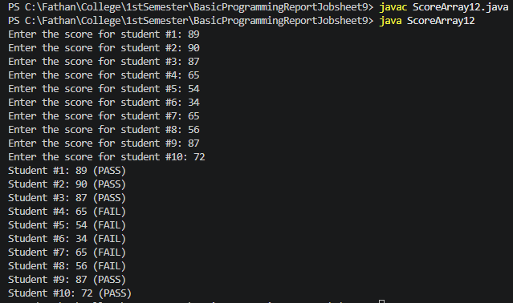
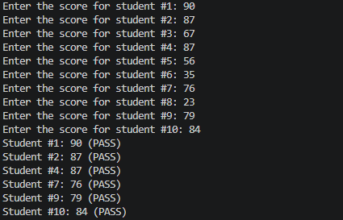
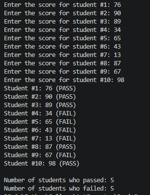

# JOBSHEET 9 - One-Dimensional Arrays

**Student Identity:**
* **Name:** Fathan Nur Hidayat
* **NIM:** 26410702084
* **Class / Student Attendance:** 1I / 12

---

## 1: OBJECTIVE

The following are the objectives of the practical work in this chapter:

1. Students are able to understand the concept of one-dimensional arrays and how to declare, initialize and access their elements in the Java programming language.
2. Students are able to write programs that use one-dimensional arrays to store and process data including the use of for and foreach loops.
3. Students are able to apply arithmetic operations to array elements, such as calculating the total average, highest value, and lowest value.
4. Students are able to apply simple searching and sorting algorithms to one-dimensional arrays.
5. Students are able to apply one-dimensional arrays to solve case studies that are relevant to campus life and everyday situations.


---

## 2: THEORETICAL BACKGROUND

### 2.1 What Is An Array? 

An array is a data structure that stores a collection of data of the same type, in sequence, within a single variable. Instead of creating a separate variable for each piece of data (for example, score1, score2, score3, ... score10), an array allows all of the data to be stored in one variable and accessed by index. In Java, arrays are homogeneous (all elements must be of the same type) and fixed in size — the size cannot be increased or decreased once the array has been instantiated.

Internally, array elements are stored contiguously in memory, so the computer can access any element directly by its index without having to traverse the preceding elements one by one. This is one reason why accessing an array element (for example, scores[5]) is very fast compared with other data structures that are not stored contiguously.

#### 2.2 Declaring and Initializing Arrays

There are several ways to declare and initialize a one-dimensional array in Java, depending on whether
the element values are known from the start or will be filled in later.

| Syntax | Explanation |
|--------|-------------|
| `int[] numbers = new int[4];` | Declares an empty array with a capacity of 4 elements. All elements are automatically filled with the default value (0 for the int type) until they are explicitly assigned. |
| `int[] numbers = {5, 13, -7, 17};` | Declares an array and initializes its element values directly. The array size automatically matches the number of values written. |
| `int[] numbers = new int[]{5, 13, -7, 17};` | Another form of direct initialization, commonly used when an array is declared as a method argument or a return value. |
| `String[] menu = {"Fried Rice", "Pulled Tea"};` | Arrays can also store non-primitive types such as String, as long as all of the elements are of the same type. |

### 2.3 Indexes, Array Length, and Common Errors

Array indexes in Java always start at 0, so the first element has index 0 and the last element has index (array length − 1). The length or capacity of an array can be obtained through the .length attribute, for example numbers.length. Note that .length is an attribute (not a method), so it is written without parentheses — unlike String, which uses the .length() method.

The most common mistake among beginners is trying to access an index outside the range of the array, for example accessing numbers[4] in an array with a capacity of 4 elements (the valid indexes are only 0 to 3). This mistake causes the program to terminate with an ArrayIndexOutOfBoundsException while it is running (a runtime error), rather than when the program is compiled.

| Default Value | Applies to Type |
| ------------- | --------------- |
| `0 (zero)` | The default value of array elements of type int or double before they are explicitly assigned|
| `false` | The default value of array elements of type boolean. |
| `null` | The default value of array elements of object/reference types, for example String. |

### 2.4 Processing Array with Loops

There are several ways to iterate over all of the elements of an array in Java, each with its own use.

| Technique | Use |
| --------- | --- |
| `for (int = 0; i < arr.length; i++)`| The most flexible approach — the index i can be used to access or modify element values, or to compare an element with another element (for example, arr[i] and arr[i+1]) |
| `for (int value : arr)` | Foreach loop (enhanced for loop) — more concise for simply reading or displaying each element, but it cannot provide the index of an element directly and cannot be used to modify the contents of the array. |
| `Arrays.toString(arr)`| A helper method from the java.util.Arrays class that displays the entire contents of an array on a single line in the format [element1, element2, ...], without the need to write a manual loop. |
|  `Arrays.sort(arr)` | A helper method for sorting an array in ascending order using an internally optimized sorting algorithm. |

### 2.5 Common Array Operations: Aggregation, Searching, and Sorting

The three most common operations applied to arrays are:
• Aggregation (total, average, maximum/minimum value) — performed by traversing all of the elements while accumulating the result in a single variable (for example, total) or comparing each element with a temporary holder variable (for example, highest).

• Searching — finding out whether a value exists in an array and, if so, at which index it is located. The simplest technique is linear search, which examines the elements one by one from the beginning until the value is found or all of the elements have been checked.

• Sorting — rearranging the elements of an array in a particular order (ascending or descending). One of the simplest sorting algorithms to learn is bubble sort, which works by repeatedly comparing two adjacent elements and swapping their positions.

To give an idea of efficiency (not to be memorized, only to build intuition), the following are the worstcase time complexities of each technique, expressed in Big-O notation — the larger n (the number of array elements) becomes, the more noticeable the difference in efficiency is:

| Operation | Time Complexity (Big-O) |
| --------- | ----------------------- |
| `Accessing an element by index (arr[i])` | O(1) — constant time, regardless of the size of the array |
| `Linear Search` | O(n) — time grows in direct proportion to the number of elements, because the elements are checked one by one. |
| `Bubble Short` | O(n²) — time grows quadratically with the number of elements, because there are two nested loops. |

### 2.6 Array vs ArrayList: When to use Which?

Java also provides the ArrayList data structure (part of the Java Collections Framework), which is similar to an array but can grow or shrink dynamically according to the needs of the program while it is running.

| Aspect | Comparison |
| ------ | ---------- |
| `Size` | An array is fixed in size from the moment it is instantiated. An ArrayList can grow or shrink dynamically. |
| `Element Type` | An array can hold primitive types (int, double, etc.) directly. An ArrayList can only hold object types (Integer, Double, etc. must be used). |
| `Performance` | Arrays are generally slightly faster and more memory-efficient because their structure is simpler. |
| `Ease of use` | ArrayList provides many ready-to-use methods (add, remove,contains, etc.) that make data processing easier than with arrays. |

As a general rule, use an array when the amount of data is known and will not change while the program is running (for example, the number of days in a week, or a fixed number of menu items). Use an ArrayList when the amount of data may grow or shrink dynamically (for example, a list of orders that keeps growing). ArrayList will be discussed in more detail in the next lab sheet.

### 2.7 Relevance of One-Dimensional Array to the Lab Case Studies

In this lab, one-dimensional arrays are applied to a case study relevant to the campus environment, namely the management of student scores in the Academic Information System (SIAKAD) — including score entry, determination of pass/fail status, and the calculation of statistics such as the average and the class grade category. One-dimensional arrays are also applied to a case study on order management at a campus café, covering the recording of the menu list, menu searching, order recording, and total cost calculation.
Both case studies represent usage patterns of arrays that are very common in real-world applications: storing a collection of similar data (student scores, a menu list, a price list), and then processing it using a combination of loops, aggregation, searching, and sorting, as explained in the previous sections.

> **Running the Program in VS Code:** All program code in this lab sheet is written and run using Visual Studio Code. Create a new file with the name requested in each step (File > New File, then save it using Save As with the appropriate name and the .java extension). To compile and run the program, open the integrated VS Code terminal via the Terminal > New Terminal menu or the shortcut Ctrl + \` (backtick), then run the command `javac FileName.java` to compile, followed by `java FileName` (without .java) to run the program.    

## 3. Lab Exercises

### 3.1 Experiment 1: Declaring, Initializing, Filling, and Displaying Array Elements

### 3.1.1 Program Code Java
```java
import java.util.Arrays;

public class NumberArray12{
    public static void main(String[] args) {
        
        int[] numbers = new int[4];
        numbers[0] = 5;
        numbers[1] = 13;
        numbers[2] = -7;
        numbers[3] = 17;

        for(int i = 0; i < numbers.length; i++){
            System.out.println("numbers[" + i + "] = " + numbers[i]);

        }
        for(int number : numbers){
            System.out.println(number);
        }
        System.out.println(Arrays.toString(numbers));
    }
}
```

#### 3.1.2 Execution Result / Screenshot Output
The following is an example of the *output* display after the program is run.:

.png)

#### 3.1.3 Answers to Questions / Reflection Questions
* **Question 1:** If the elements of the numbers array are changed to 5.0, 12867, 7.5, 2000000, what happens? Why does this happen?
  * **Answer:** Error, because the data type is integers, so we cannot input the double data type.
* **Question 2:** Modify the program above by initializing the array elements at the same time the array is declared (without new int[4] and without filling the elements one by one).
  * **Answer:** 
```java
import java.util.Arrays;

public class NumberArray12{
    public static void main(String[] args) {
        
        int[] numbers = {5, 13, -7, 17};

        for(int i = 0; i < numbers.length; i++){
            System.out.println("numbers[" + i + "] = " + numbers[i]);

        }
        for(int number : numbers){
            System.out.println(number);
        }
        System.out.println(Arrays.toString(numbers));
    }
}
```
* **Question 3:** Change the display statement in step 4 to the following: System.out.println("numbers[" + i + "] = " + numbers[i] + ", doubled = " + (numbers[i] * 2)); What is the output of the program? Explain the meaning of the statement.
  * **Answer:** The output of the program is: .png)
  The meaning of the statement is to doubled the i (multiplied by 2) and show the result of it.
* **Question 4:** If the condition in the for loop above is changed to i <= 4, what is the output of the program? Why?
  * **Answer:** It will show `Exception in thread "main" java.lang.ArrayIndexOutOfBoundsException: Index 4 out of bounds for length 4 at NumberArray12.main(NumberArray12.java:9)`. It's because the array is only have 4 elements, and index 4 would be the fifth element, which isn't there.

Result

* **Question 5:** What is the difference between displaying an array using a for loop, a foreach loop, and Arrays.toString() in step 5? When should each one be used?
  * **Answer:** The classic for loop gives full control through an index, so it suits cases where the index is needed, elements must be modified, or traversal is unusual, though it is more prone to off-by-one errors. The for-each loop (for (int number : numbers)) is shorter and safer, making it ideal for simply reading each element, but it has no index and cannot modify primitive elements. Arrays.toString(nums) prints the whole array in one line, such as [5, 13, -7, 17], which is best for quick output and debugging, though its format is fixed and multidimensional arrays need Arrays.deepToString().
---

### 3.2 Experiment 2: SIAKAD Case Study — Entering Student Scores and Pass/Fail Status

In the Academic Information System (SIAKAD), lecturers need to enter students' final scores and quickly determine the pass/fail status of each student.

#### 3.2.1 Program Code Java
```java
import java.util.Scanner;

public class ScoreArray12{
    public static void main(String[] args) {
        Scanner input = new Scanner(System.in);

        int[] finalScores = new int[10];

        for (int i = 0; i < finalScores.length; i++) {
            System.out.print("Enter the score for student #" + (i + 1) + ": ");
            finalScores[i] = input.nextInt();
        }
        for (int i = 0; i < finalScores.length; i++) {
            String status = (finalScores[i] > 70) ? "PASS" : "FAIL";
            System.out.println("Student #" + (i + 1) + ": " + finalScores[i] + " (" + status + ")");
        }
        input.close();
    }
}

```
#### 3.2.2 Execution Result / Screenshot Output
The following is an example of the *output* display after the program is run.:


#### 3.2.3 Answers to Questions / Reflection Questions
* **Question 1:** What does the condition i < finalScores.length in the loop above mean?
  * **Answer:** finalScores.length is the number of elements in the array, which is 10 here. The loop runs while i is less than 10, so i takes the values 0 through 9. These are exactly the valid indexes of the array, because Java arrays start at index 0 and the last index is length - 1.
* **Question 2:** Modify the program so that it displays only the scores of students who passed (score > 70), without displaying those who failed. Explain the flow of the program!
  * **Answer:** Output program: 
```java
for (int i = 0; i < finalScores.length; i++) {
            if (finalScores[i] > 70) {
                String status = "PASS";
                System.out.println("Student #" + (i + 1) + ": " + finalScores[i] + " (" + status + ")");
            }
        }
```
* **Question 3:** Change the loops in steps 4 and 5 from for loops to foreach loops. Can all parts of the program be converted to foreach? Explain which parts can and cannot be converted, along with the reasons.
  * **Answer:** Yes, it can be inverted to foreach, but it only reads values, so for-each works. However, for-each gives no index, so the student number (i + 1) must be tracked with a separate counter variable like number, as shown below.
```java
int number = 1;
for (int score : finalScores) {
    String status = (score > 70) ? "PASS" : "FAIL";
    System.out.println("Student #" + number + ": " + score + " (" + status + ")");
    number++;
}
```
    A for-each loop can be used when a loop only reads the elements of an array, but a classic for loop must be kept when the loop writes values into the array or needs the index.
* **Question 4:** Modify the program so that it also calculates and displays the number of students who passed and the number of students who failed at the end of the program.
  * **Answer:** Output modified program code: 
```java
import java.util.Scanner;

public class ScoreArray12{
    public static void main(String[] args) {
        Scanner input = new Scanner(System.in);

        int[] finalScores = new int[10];
        int passCount = 0, failCount = 0;
        for (int i = 0; i < finalScores.length; i++) {
            System.out.print("Enter the score for student #" + (i + 1) + ": ");
            finalScores[i] = input.nextInt();
        }
        for (int i = 0; i < finalScores.length; i++) {
            String status;
            if (finalScores[i] > 70) {
                status = "PASS";
                passCount++;
            } else {
                status = "FAIL";
                failCount++;
            }
            System.out.println("Student #" + (i + 1) + ": " + finalScores[i] + " (" + status + ")");
        }

        System.out.println();
        System.out.println("Number of students who passed: " + passCount);
        System.out.println("Number of students who failed: " + failCount);
        input.close();
    }
}
```

---

### 3.3 Experiment 3:  Arithmetic Operations on Arrays — Total, Average, Highest and Lowest Scores

This experiment continues the SIAKAD case study to produce a summary of student scores, as commonly shown in an end-of-semester score recap.

#### 3.3.1 Program Code Java
```java

```

#### 3.3.2 Execution Result / Screenshot Output
The following is an example of the *output* display after the program is run.:


#### 3.3.3 Answers to Questions / Reflection Questions
* **Question 1:**
  * **Answer:** 
* **Question 2:** 
  * **Answer:**
* **Question 3:** 
* **Question 4:** 
  * **Answer:** 
---

### 3.4 Experiment 4: Simple Searching and Sorting

This experiment applies simple searching and sorting algorithms to student score data — two fundamental skills that are widely used in real-world data processing.

#### 3.4.1.1 Program Code Java (Part A - Linear Search)
```java

```
#### 3.4.1.2 Program Code Java (Part B - Bubble Sort)
```java

```


#### 3.4.2 Execution Result / Screenshot Output
The following is an example of the *output* display after the program is run.:


#### 3.4.3 Answers to Questions / Reflection Questions
* **Question 1:**
  * **Answer:** 
* **Question 2:** 
  * **Answer:**
* **Question 3:** 
  * **Answer:**
* **Question 4:** 
  * **Answer:** 
* **Question 5:** 
  * **Answer:** 
---

## 4: ASSIGNMENT

### 4.1 Assignment 1: Managing Student Scores
Write a program that can store and manage student scores (integers). The program must provide features to:
• Enter the number of student scores to be input.
• Enter each student score one by one.
• Calculate the average of all of the scores entered.
• Display the highest and lowest scores.
• Display all of the scores entered, along with their pass/fail status (PASS / FAIL)

### 4.1.1 Program Code Java
```java

```

#### 4.1.2 Execution Result / Screenshot Output


### 4.2 Assignment 2: Campus Café Ordering Application
Write a program that can manage food and beverage orders at a campus café. The program provides a predefined menu list, allows users to select menu items through a search feature, records orders, and calculates the total cost.
Café menu list (initialize an array of String at declaration):
```java
String[] menu = {"Fried Rice", "Fried Noodles", "Toast", "French Fries", "Pulled Tea", "Cappuccino", "Chocolate Ice"};
int[] prices = {15000, 13000, 10000, 12000, 8000, 18000, 20000};
```
The program you write must meet the following requirements:
• Menu search feature: the user enters the name of the food or beverage they want to order, and the program searches for that name in the menu array using the linear search algorithm. If it is found, display its price; if it is not found, inform the user that the menu item is not available.
• Ordering feature: the user enters the number of items to order, then for each item selects a menu name (which must be validated to ensure it exists in the menu list). Store the names of the ordered items in a one-dimensional array that is separate from the main menu array.
• Calculate and display the total cost of all of the orders entered by the user.
• Display the list of orders that have been made, along with the total cost, in a neat and easy-to-read format.

### 4.2.1 Program Code Java
```java

```

#### 4.2.2 Execution Result / Screenshot Output


--- 

## 5: CONCLUSION